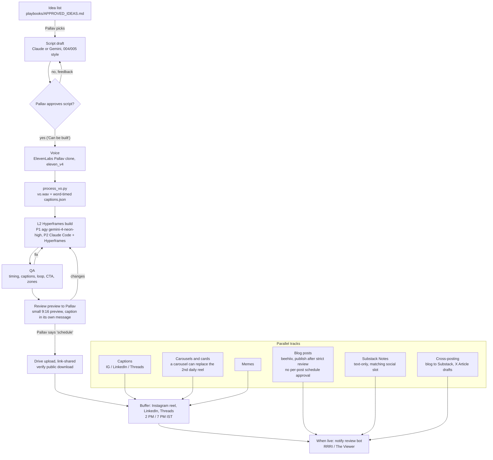

# Quit 9to5 content workflow (portable playbook)

This repo holds Pallav Kulhari's content-creation workflow for the launch of his book *Quit 9to5* (Embassy Books, January 2027). It is written so that an agent **outside** the box Grok Bot runs on (Claude Code, Gemini CLI, Antigravity `agy` or similar) can run the same pipelines once Pallav shares tool access (API keys, MCP connectors, CLIs).

It is a playbook with scripts and examples. It is not a copy of the working box: it contains no media, no secrets, no account IDs and no book manuscript text.

**Goal of all content:** waitlist signups at [quit9to5.in](https://www.quit9to5.in/).

## Who it is for

- **An agent** picking up a content task: start with the doc for that task in `docs/`, and obey `rules/` before anything else.
- **Pallav or a helper** setting up a new machine: start with [SETUP.md](SETUP.md).
- **Whoever runs the Saturday refresh**: [SYNC.md](SYNC.md).

## How to start

1. Read the three rule files. They override everything else:
   - [rules/approval-gates.md](rules/approval-gates.md): what needs Pallav's explicit OK (almost everything).
   - [rules/content-rules.md](rules/content-rules.md): CTA, hooks, facts, finance caveats, paid-service rule, review-bot notification.
   - [rules/voice-and-style.md](rules/voice-and-style.md): how Pallav sounds in published work.
2. Set up tools and placeholders: [SETUP.md](SETUP.md) and [.env.example](.env.example).
3. Open the doc for your job:

| Job | Doc | Prompt |
|---|---|---|
| Instagram reel, end to end | [docs/reels.md](docs/reels.md) | [prompts/script-reel-claude.md](prompts/script-reel-claude.md), [prompts/script-reel-gemini.md](prompts/script-reel-gemini.md) |
| Captions (Instagram, LinkedIn, Threads) | [docs/captions.md](docs/captions.md) | [prompts/caption-pack.md](prompts/caption-pack.md) |
| Buffer scheduling | [docs/scheduling-buffer.md](docs/scheduling-buffer.md) | |
| Blog post (beehiiv, Substack) | [docs/blog.md](docs/blog.md) | [prompts/blog-post.md](prompts/blog-post.md) |
| Substack Notes | [docs/substack-notes.md](docs/substack-notes.md) | [prompts/substack-note.md](prompts/substack-note.md) |
| Carousels and cards | [docs/carousels-and-cards.md](docs/carousels-and-cards.md) | [prompts/carousel-or-cards.md](prompts/carousel-or-cards.md) |
| Memes | [docs/memes.md](docs/memes.md) | |
| Cross-posting | [docs/crossposting.md](docs/crossposting.md) | |

4. Reference material:
   - [playbooks/](playbooks/): the living rulebooks copied from the box. [playbooks/SCRIPT_PLAYBOOK.md](playbooks/SCRIPT_PLAYBOOK.md) is the source of truth for reel scripts.
   - [skills/instagram-reel-script/SKILL.md](skills/instagram-reel-script/SKILL.md): the reel-scripting skill, patched with the 21 Nov 2026 rules.
   - [examples/](examples/): the two canonical approved reels, 004 runway and 005 toxic hike (scripts, captions, Threads text, build briefs).
   - [scripts/](scripts/README.md): voiceover processing, CTA splice, contact sheets, the `agy` builder runner, card/blog/cover generators, the L2 reference builder.
   - [docs/SECRETS-SCAN.md](docs/SECRETS-SCAN.md): the redaction scan and its known false positives.

## The workflow at a glance



## Cadence (current experiment, from 21 Nov 2026)

- Two reels a day, at **2:00 PM and 7:00 PM IST**. On some days a carousel replaces the second (7 PM) reel.
- Blog: Tue, Thu and Sat around 10:00 AM IST.
- All times are Asia/Calcutta (IST, UTC+05:30). Build Buffer `dueAt` values with `+05:30`.

## Channels in scope

| Channel | Account | How content gets there |
|---|---|---|
| Instagram | @quit9to5book | Buffer, automatic Reels (no music) |
| LinkedIn Page | "Quit 9to5" | Buffer, automatic |
| Threads | @quit9to5withpallav | Buffer, automatic (500-character limit) |
| Blog | blog.quit9to5.in (beehiiv) | Browser, web only, no email send |
| Substack | pallavkulhari.substack.com (Quit 9to5) | Browser: posts (approval needed) and text-only Notes |
| X | @pallavkulhari | **Articles only**, drafted for Pallav. X is not a Buffer channel any more. |
| Waitlist | quit9to5.in | The only CTA destination |

Out of scope and deliberately absent: Quora and Reddit (stopped), and the book manuscript (`manuscript.md`, private, not included).

## Repo layout

```
README.md  SETUP.md  SYNC.md  CHANGELOG.md  NOTICE  .env.example  .gitignore
docs/       operational guides, one per pipeline (curated)
rules/      voice, content rules, approval gates (curated, highest priority)
prompts/    reusable prompts for Claude / Gemini (curated)
scripts/    ported tools with paths parameterised; sync_from_box.sh (curated)
playbooks/  sanitised copies of the box's living rulebooks (generated weekly)
examples/   text of the approved reels 004 and 005 (generated weekly)
skills/     reel-script skill snapshot + Quit 9to5 patch (SKILL.md generated, patch curated)
```

See [NOTICE](NOTICE): this is Pallav's private workflow.
